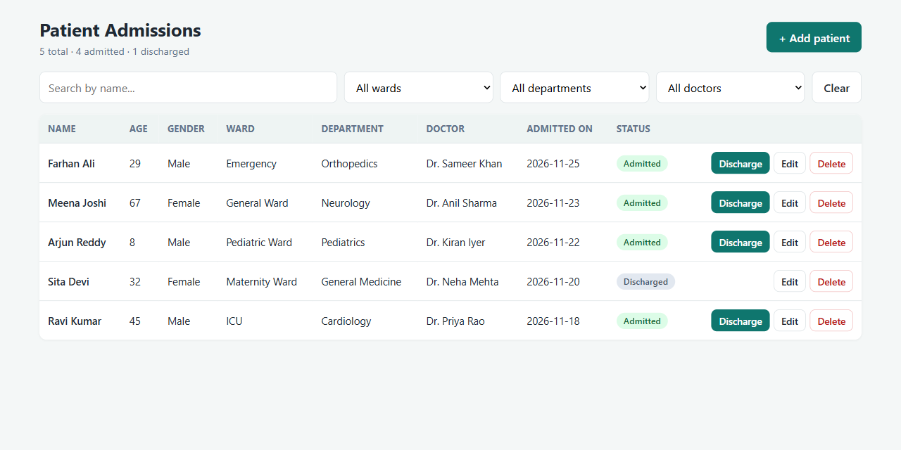
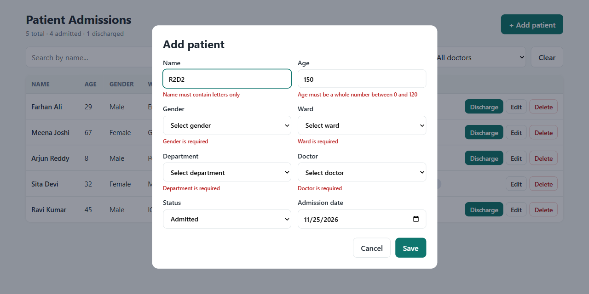
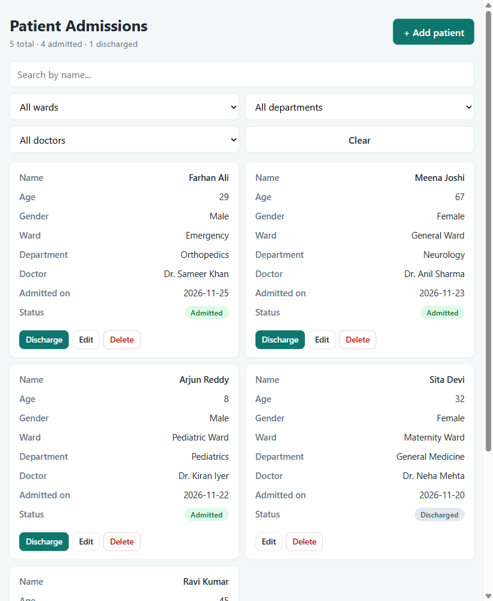
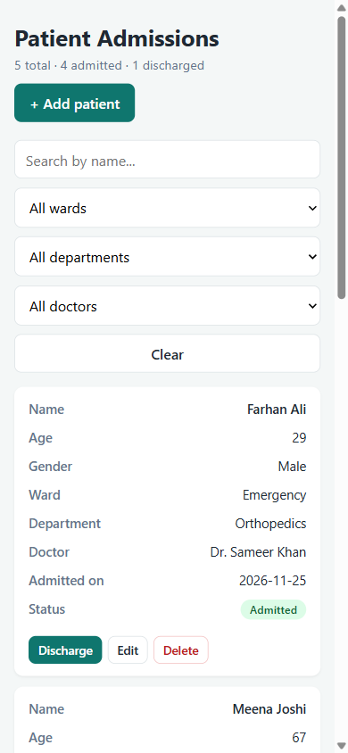

# Patient Admission Management App

Web app for hospital staff to manage admitted patients - add, view, search, filter, edit, discharge and delete.

Live link: https://frontend-sigma-swart-79.vercel.app
API: https://patient-admission.vercel.app

## Tech stack

- Frontend: React (Vite), plain CSS
- Backend: Python, Flask
- Database: PostgreSQL (Neon) on the live site, SQLite file when running locally. Both keep data after a server restart.

## Features

1. Add a patient
2. View the list of all patients (with total, admitted and discharged counts)
3. Filter by ward, department and doctor
4. Search patients by name
5. Edit a patient
6. Delete a patient (asks for confirmation first)
7. Mark a patient as discharged
8. Works on mobile, tablet and desktop (on smaller screens the table turns into cards)

## Validation

Same rules are checked in the frontend (`frontend/src/utils/validate.js`) and the backend (`backend/validation.py`):

- Name - required, letters only (spaces allowed between words)
- Age - required, whole number from 0 to 120
- Gender, Ward, Department, Doctor - required, must be one of the given options
- Admission date - required, can't be a future date

If the backend gets bad data it rejects it with `400` and a clear message, for example:

```json
{ "message": "Age must be a whole number between 0 and 120", "errors": { "age": "..." } }
```

## Folder structure

```
backend/
  app.py              API routes
  db.py               database connection and table setup
  validation.py       validation rules
  options.py          dropdown values (wards, doctors etc.)
  requirements.txt
frontend/src/
  App.jsx             page state and API calls
  components/
    Filters.jsx       search box and filters
    PatientTable.jsx  patient list
    PatientForm.jsx   add / edit form
  utils/
    api.js            fetch helper
    validate.js       frontend validation
  styles.css
```

To add a new ward, doctor or department, just edit `backend/options.py`. The frontend loads the lists from `/api/options`, so nothing else needs to change.

## API

| Method | Endpoint                         | Description        |
|--------|----------------------------------|--------------------|
| GET    | /api/options                     | dropdown values    |
| GET    | /api/patients                    | list patients      |
| POST   | /api/patients                    | add patient        |
| PUT    | /api/patients/:id                | update patient     |
| PATCH  | /api/patients/:id/discharge      | discharge patient  |
| DELETE | /api/patients/:id                | delete patient     |

## Running locally

Backend:

```bash
cd backend
python -m venv venv
venv\Scripts\activate        # on Mac/Linux: source venv/bin/activate
pip install -r requirements.txt
python app.py
```

Runs on http://localhost:5000

Frontend (in another terminal):

```bash
cd frontend
npm install
npm run dev
```

Runs on http://localhost:5173 and calls the local backend at http://localhost:5000. The deployed site calls the live backend (set in `frontend/src/utils/api.js`).

## Deployment

Both parts are deployed on Vercel as two separate projects from this repo.

Backend:

1. Add New -> Project -> import this repo, set root directory to `backend` (Vercel detects Flask)
2. Deploy, then go to Storage -> Create Database -> Neon (Postgres) and connect it to this project. This adds `DATABASE_URL`.
3. Redeploy so the backend picks up `DATABASE_URL`
4. Settings -> Deployment Protection -> turn off Vercel Authentication so the API is public

Frontend:

1. Add New -> Project -> import the same repo, set root directory to `frontend`
2. Deploy (the backend URL is already set in `frontend/src/utils/api.js`)

## Screenshots

Desktop



Validation errors in the add form



Tablet



Mobile


